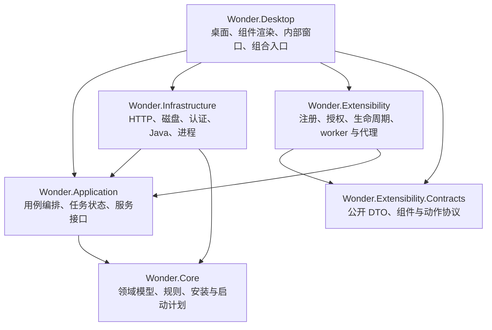
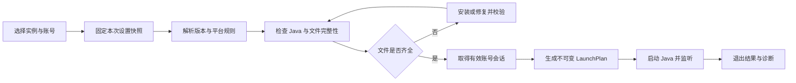

# 奇想我的世界启动器：新架构方案

状态：目标架构。创建于 2026-09-30；2026-10-25 已整理本地工程。桌面、组件契约和本地离线启动已部分落地；worker、外部插件加载与沙箱仍待实现。当前完成范围见 [Wonder.md](../Wonder.md)，产品约束见 [12-product-goals.md](12-product-goals.md)。

## 1. 名称与产品方向

- 中文全名：**奇想我的世界启动器**。
- 英文全名：**Wonder Minecraft Launcher**。
- 界面短名：**Wonder Launcher**；技术简称：**WML**。
- 新程序集和命名空间统一使用 `Wonder.*`。

Wonder 表达对世界的惊奇、想象与探索，和“奇想”的气质相符。名称是本轮产品命名决定，未声称域名、包名或商标可用性已验证。主目录为 `Wonder Minecraft Launcher`，只包含 Wonder 工程。

首个可用版本面向 Minecraft Java Edition。优先完成 Windows 桌面验证，核心接口按跨平台设计；macOS/Linux 在各自完成运行验收后再列为支持平台。这是建议的交付顺序，不是已有能力。

主界面是用户自己的游戏桌面：功能以可摆放的组件、快捷入口和内部工具窗口呈现。用户可以自行组合布局、增加插件能力，并通过桌面完成实例选择、账号管理、安装与启动。工作区和插件框架属于产品基础；轻量化通过有限的内置能力、按需加载和资源预算实现。

## 2. 重建原则

1. 仅从现存源码挑选有价值的逻辑，不恢复历史提交、暂存代码或缺失旧文件。
2. 使用全新的应用数据目录与配置版本，不扫描或迁移旧启动器账号、配置、布局、缓存、插件数据。
3. 已有 Minecraft 游戏目录只有在用户主动选择后才可识别；这属于导入游戏文件，不是自动迁移旧启动器数据。
4. 从首阶段建立桌面工作区、统一组件契约和插件宿主，内置组件与示例插件一起验证；原版安装/登录/启动闭环通过这套机制交付。基本功能不依赖用户额外安装第三方插件。
5. UI 只呈现状态和发送操作，不直接组装 Java 命令、刷新令牌或修改安装中的文件。
6. 失败、取消、重试都是正式状态；“窗口能打开”不等于启动器已可用。
7. 源码按职责模块化，发布时整合为单个应用；插件、游戏和用户数据按需外置，不把模块化误解为分发一堆必需程序。

## 3. 技术选择

建议继续使用 C#、.NET 10 和 Avalonia，减少语言与 UI 技术切换成本。当前机器已核实具有 SDK `10.0.302`。微软将 .NET 10 列为 LTS；实施时固定 SDK 和经过还原、构建验证的依赖版本。[官方 .NET 支持策略](https://dotnet.microsoft.com/en-us/platform/support/policy)

Avalonia 官方支持桌面 Windows、macOS 和 Linux，但支持等级随系统版本变化。因此保留跨平台结构、逐平台验收，不复制旧 README 的平台保证，也不直接照抄旧 Avalonia 包版本。[Avalonia 平台说明](https://docs.avaloniaui.net/docs/supported-platforms)

桌面采用 MVVM 和显式依赖注入。四个游戏/应用基础工程之外，从开始加入独立扩展契约和扩展运行时，共六个生产工程；不为每个组件单独拆程序集。通用日志、HTTP、JSON 与进程能力优先采用 .NET 现有设施；只有必要的副作用或替换点定义接口。

## 4. 工程边界与依赖



箭头表示编译依赖。Desktop 对 Infrastructure 的依赖只用于启动时装配服务，ViewModel 不调用具体实现。Core 不引用 Avalonia、扩展 SDK 或应用层；Application 不引用 Infrastructure 或扩展运行时。Contracts 不引用上述任何工程，也不引用 Avalonia；Extensibility 通过适配器把公开协议映射到应用服务，不向插件透出内部对象。

| 工程 | 负责 | 不承担 |
|---|---|---|
| `Wonder.Core` | 实例标识、版本模型、规则求值、参数模板、安装计划、不可变启动计划、结构化错误 | UI、磁盘操作、HTTP、启动进程 |
| `Wonder.Application` | 实例发现、安装/修复/启动、登录等用例；并发锁、取消、进度与状态转换；外部服务接口 | 页面控件、HTTP 细节和操作系统凭据实现 |
| `Wonder.Infrastructure` | 文件存储、网络请求/下载、校验、凭据存储、Java 探测、进程管理；把协议 DTO 转成核心模型 | 页面状态与控件交互 |
| `Wonder.Desktop` | 桌面画布、组件库、任务栏、内部窗口、统一渲染与交互、内置 UI 贡献；服务装配与入口角色分流 | 拼命令行、直接读写账号令牌、决定安装事务 |
| `Wonder.Extensibility.Contracts` | 清单/组件/动作/服务 DTO 与版本协商协议，框架无关 SDK | 宿主内部类型、控件、任意服务定位器 |
| `Wonder.Extensibility` | 贡献注册、安装与依赖检查、权限与服务代理、生命周期、消息协议和 worker 管理 | Minecraft 规则实现、UI 控件渲染 |

建议目录，尚未创建：

```text
WonderLauncher.slnx
global.json
Directory.Build.props
Directory.Packages.props
src/
  Wonder.Core/
    Instances/ Versions/ Launching/ Installation/
  Wonder.Application/
    Instances/ Launching/ Installation/ Accounts/ Tasks/ Ports/
  Wonder.Infrastructure/
    Minecraft/ Downloads/ Storage/ Authentication/ Java/ Processes/
  Wonder.Desktop/
    Workspace/ Components/ Windows/ BuiltIns/ ViewModels/ Theming/
  Wonder.Extensibility.Contracts/
    Manifests/ Contributions/ Components/ Actions/ Services/ Protocol/
  Wonder.Extensibility/
    Catalog/ Packages/ Lifecycle/ Permissions/ Broker/ Workers/
tests/
  Wonder.Core.Tests/
  Wonder.Application.Tests/
  Wonder.Infrastructure.Tests/
  Wonder.Workspace.Tests/
  Wonder.Extensibility.Tests/
samples/
  Wonder.SamplePlugin/               独立 SDK 消费者，不编入本体
Guides/
```

新项目文件显式限定各自源码范围，不把根目录残余代码通配编入。示例插件仅引用新 SDK；用它检验公开契约是否足够，不让示例直接引用宿主实现。内置模块静态编入本体并按需实例化，共用组件与动作契约；特权服务仍由应用层拥有。

## 5. 关键模型与接口

以下名称表达设计责任，并非已存在 API。

| 模型/接口 | 内容与约束 |
|---|---|
| `GameInstance` | 新实例 ID、用户可见名称、绝对游戏路径、目标版本、实例设置；不使用旧启动器实例 ID |
| `ResolvedVersion` | 已解析继承关系、主类、库、资产、规则和版本参数；与原始网络 DTO 分离 |
| `JavaRuntime` | 可执行路径、版本、架构与探测结果；兼容性由版本要求决定，不硬编码一个 Java 版本支持全部游戏 |
| `InstallPlan` | 目标文件、来源、校验值、大小、最终位置；一轮操作使用固定元数据快照 |
| `LaunchPlan` | Java 路径、工作目录、不可变参数数组、环境变量、ClassPath、关联任务 ID；不在运行时重新读取配置 |
| `AccountSession` | 当前所需身份与短期凭据；不直接序列化到普通配置，UI 只得到可展示的摘要 |
| `ILaunchPlanBuilder` | 从已解析版本、实例设置、Java 与有效会话构建计划；不执行进程 |
| `IGameProcessRunner` | 通过计划启动 Java，异步收集输出、退出码、崩溃信息和生命周期 |
| `IDownloadService` | 下载、取消、有限重试和流式进度；校验完成后提交文件 |
| `IAccountService` / `ICredentialStore` | 获取与刷新会话；系统凭据存储通过平台适配提供 |
| `IInstanceRepository` / `ISettingsStore` | 新数据模式、原子写入、格式校验、可诊断错误 |
| `ComponentDefinition` / `ComponentInstance` | 定义 ID 与实例 ID 分离；尺寸约束、多实例策略、状态与动作；同定义可放置不同配置的实例 |
| `WorkspaceProfile` / `IWorkspaceStore` | 新工作区布局、窗口偏好、层级与锁定；空工作区合法，不导入旧布局 |
| `IContributionRegistry` / `IPluginBroker` | 有所有者和版本的贡献注册；按会话身份逐次校验能力并转发允许的服务请求 |

不为纯值转换建立多层接口。接口优先覆盖网络、时钟、磁盘、进程和凭据等测试替换点。

## 6. 原版启动闭环



应用层可先检查账号状态，但在真正执行前保证会话仍有效。修复必须产生可见任务；校验仍失败时结束任务并给出错误，不无限循环。原版元数据解析需覆盖继承循环、缺失父版本、平台库规则、原生库、资源索引、现代与旧式参数表达；首轮验收明确列出覆盖的游戏版本，不能声称支持所有历史版本。

执行器使用 `ProcessStartInfo.ArgumentList` 逐项传参并显式关闭 shell 执行，避免自行拼接带空格路径和引号。该 API 接受单独参数，由框架处理必要转义。[Microsoft 参数列表文档](https://learn.microsoft.com/en-us/dotnet/api/system.diagnostics.processstartinfo.argumentlist?view=net-10.0)

日志只记录脱敏后的诊断视图，不输出实际 access token、refresh token 或带凭据的完整命令行。内部 `LaunchPlan` 可能包含敏感启动参数，保持短期内存生命周期，不将它原样持久化或发给 UI。

## 7. 安装、任务与故障处理

安装流程：获取并固定元数据 → 解析 `InstallPlan` → 下载到暂存区 → 按元数据校验 → 在目标文件系统内提交 → 最后写入实例完成状态。下载中断、校验失败或取消不能产生“已安装完成”的实例。

首版只要求任务级取消、失败后的安全重试和复用已校验完整文件；断点续传可以后续实现，不把服务器是否支持 Range 当首版必要条件。解压前校验条目目标路径，不能写出指定目录。

同一实例的安装、修复与启动互斥，跨实例任务采用有限并发。任务由应用层持有，切换页面不会取消任务；任务页提供显式取消按钮。游戏启动前的取消与游戏运行后的终止分别建模，不因导航或关闭进度面板杀掉游戏。

建议任务状态：`Queued → Resolving → Running → Verifying → Completed`，并可进入 `Cancelled` 或 `Failed`。启动任务额外显示“启动中、游戏运行中、已退出”。失败记录包含错误码、发生阶段、可重试性和用户可采取的动作，底层异常放入脱敏诊断日志。

## 8. 账号与全新数据

当前数据根为程序旁的 `WonderData/`，普通设置、工作区、实例索引、日志与缓存分别存储。各文件独立维护格式版本；未来账号元数据与密钥应分开保存。前身产品的数据目录不列入发现路径。

微软登录使用独立应用注册与官方支持的授权流程；具体 Client ID、授权配置和账号测试须在账号阶段准备，不借用旧启动器凭据或假造成功结果。刷新失败需要可恢复的重新登录状态。离线身份如果提供，应作为明确模式，不把网络故障或登录失败静默变成离线账号。

实施时再核对当前 Microsoft/Minecraft 认证协议、权限与平台凭据接口，本方案不预先固定未经验证的端点或权限范围。首个完整可用版本必须实际验证账号登录、会话刷新与原版启动；仅有假会话的测试不算完成。

全新存储只对新配置自身的写入失败提供恢复能力，不读取旧产品数据。对用户主动选取的游戏文件，先只读发现，任何修复或安装作用于明确选定的实例目录。

## 9. 桌面工作区与组件交互

| 桌面对象 | 首版承担的真实任务 |
|---|---|
| 工作区 | 摆放组件、背景、编辑模式、拖动/缩放/层级/锁定、布局保存与恢复 |
| 组件库 | 搜索、预览、添加内置和插件组件；区分定义和实际运行实例 |
| 任务栏与快捷入口 | 打开组件库/设置/诊断，管理内部窗口，查看任务；空桌面仍可找回功能 |
| 内部工具窗口 | 实例管理、安装器、账号、插件和设置等复杂交互；由宿主管理焦点、最小化和关闭 |
| 内置基础组件 | 实例选择、账号摘要、启动动作、任务进度；可移动、移除与配置 |
| 插件贡献 | 使用同一组件/窗口/动作模型；故障时局部占位，其他组件继续可用 |

主交互以桌面工作区为中心。首次布局提供基本组件，用户清空后保持空白；宿主入口继续可达。组件点击与拖拽分离，内部窗口和菜单有受控层级，插件不能盖住权限提示。保存逻辑坐标，改变窗口大小时提供找回组件能力，临时可见范围修正不覆盖用户原布局。

隐藏或移除组件只改变视图生命周期，任务与游戏会话由应用服务持有。设置影响新操作，运行中的任务使用固定快照。明暗主题、键盘导航和可访问性从基础阶段实现。具体交互和生命周期约束见 [产品目标第 2 节](12-product-goals.md#2-桌面式交互模型)。新品牌素材独立设计。

## 10. 残存逻辑进入新工程的方式

| 残存逻辑 | 迁入条件 |
|---|---|
| 启动变换与参数检查 | 去除旧类型依赖；纯规则和文件访问分开；用真实不可变计划收口；通过参数顺序、路径和冲突测试 |
| 几何与坐标换算 | 作为桌面基础阶段的优先提取候选；校验输入与复制集合；只保留当前算法，不引入旧布局迁移 |
| 主题值模型 | 重新命名与定义默认色板；由新主题服务实现状态变化 |
| 多边形组件校验 | 在首阶段定义新组件契约，再按规则提取；先处理比较器不一致与快照顺序 |
| 旧目录项、插件接口与空示例 | 不直接编入新工程；按新需求重新定义 |

每次提取以一项可验证行为为单位，不通过补齐大量旧类型来让残缺旧项目勉强编译。旧命名空间不进入新的公开接口。

## 11. 插件、轻量化与单应用发布

扩展贡献从首阶段包含组件、窗口与动作，后续逐步增加主题、内容源、加载器、安装与启动变换。用独立示例插件验证公开 SDK，不在游戏闭环完成后才补插件基础。所有扩展有所有者、版本、依赖、权限、生命周期和明确故障状态，加载器与桌面组件不共用无边界上下文。

常规 UI 由宿主校验声明并渲染，代码插件按需使用 worker。普通子进程和程序集加载上下文不能代替操作系统沙箱；受限代码模式的正式开放以平台隔离验证为门槛，未达标时仅开放声明式扩展及明确标注权限的开发/高级模式。权限代理、故障策略、包安装与启动链冲突规则见 [产品目标第 4 节](12-product-goals.md#4-严密而可扩展的插件体系)。在线插件目录保持独立，由启动器消费。

按需激活、事件订阅、不可见暂停与空闲 worker 退出共同控制成本，性能报告覆盖整个进程树。第一阶段固定基准环境和回归预算，不用未测量的体积或内存数字宣传轻量。[性能验收定义](12-product-goals.md#5-轻量化的可测定义)

Windows 首发以单个自包含 `WonderLauncher.exe` 为分发目标，内部模块发布时合并，插件/Java/数据外置。同一个 EXE 在初始化 UI 前按普通或 worker 角色分流；不要求单进程。首轮采用 .NET 单文件发布验证路径，暂不启用与动态程序集扩展冲突的 Native AOT/全量裁剪。官方依据与发布验收见 [单应用分发](12-product-goals.md#6-单应用分发)。

音乐、AI、复杂动画不列入首版，后续按新需求评估。旧布局迁移与旧 API 兼容不在新项目范围内。
