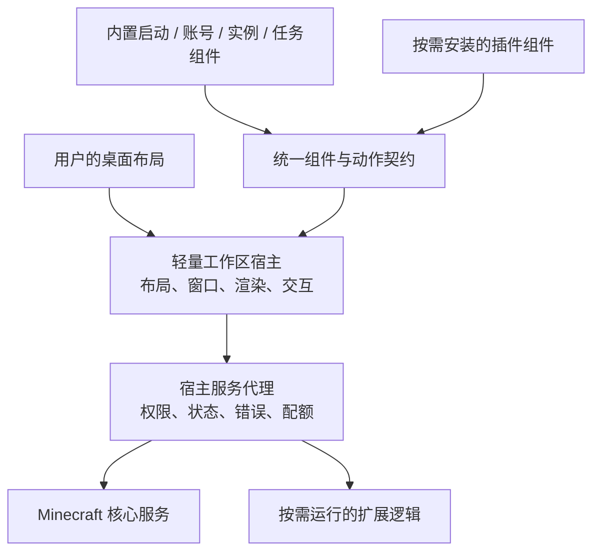

# 产品目标：可自由组合的游戏桌面

状态：用户目标已明确，本文将其转化为待实现的设计约束。创建于 2026-09-30，复核于 2026-10-01。

**奇想我的世界启动器 / Wonder Minecraft Launcher：以桌面式工作区承载可自由组合的功能组件，以严密、可持续扩展的插件体系提供丰富能力，保持本体轻量，并以单个应用交付。**

这是新产品的核心方向。桌面工作区、组件化、插件基础和单应用分发从第一阶段进入设计与验证，不能等到传统页面式启动器做完后才附加。

这五项目标来自用户要求；下文的工程划分、worker、权限模式和发布选项是为实现目标提出的设计建议，仍需工程验证，不表示这些能力已经实现。

## 1. 五个目标如何落地

| 用户目标 | 新产品的设计约束 | 验收方式 |
|---|---|---|
| 交互像电脑桌面 | 主界面是工作区，配合组件库、快捷入口、任务栏和内部工具窗口 | 实际完成拖放、缩放、层级、窗口切换、最小化/恢复等操作 |
| 用户自由定制、功能模块化 | 内置与插件使用统一组件定义、实例、布局、状态和动作契约；可移除、重排、多实例与定制外观 | 不改本体源码即可改变布局并安装新的功能组件 |
| 插件严密、扩展能力强 | 稳定 SDK、版本协商、权限、生命周期、依赖、故障隔离、事务安装和诊断均有明确规则 | 独立编译示例插件，以及拒绝越权、崩溃、超时、升级失败等测试 |
| 本体轻量 | 必要游戏核心与工作区宿主留在本体，可选能力按需安装、按需激活 | 分别测量本体和全部 worker 的体积、启动时间、内存与空闲 CPU |
| 单个应用便于传播 | Windows 首发以单个自包含 EXE 为目标；源代码保持多模块 | 在没有开发 SDK/.NET 预装的干净测试环境，仅复制 EXE 即可打开默认桌面 |

“首版”仍需缩小功能范围，但不能删掉这些目标的最小闭环。丰富生态可以逐步增加，扩展接口与边界必须先成立。

## 2. 桌面式交互模型

### 工作区

工作区是用户布置组件的画布，保存布局、背景和主题偏好。首版先完成单工作区；多工作区、分组和布局预设建立在相同模型上，不预先堆满界面。

支持拖动、按组件允许的范围缩放、选择、置前/置后、锁定与移除。拖拽吸附和对齐可关闭；日常使用与布局编辑有清楚的状态，避免拖动与按钮点击冲突。组件内交互区域与拖拽区域分离，不强迫所有功能套用一种固定卡片尺寸或固定形状。

缩小窗口或改变 DPI 后，组件仍可被找回；提供“整理到可见范围”。重置布局必须是明确操作，用户自行清空工作区后保持空白，不自动补回默认组件。空白桌面仍能通过宿主入口打开组件库、设置和诊断。

### 组件库、任务栏与内部窗口

组件库用于发现、搜索、预览和添加组件；收藏或常用组件可作为快捷入口。每个组件定义有稳定 ID，同一定义可以有多个独立实例；确需单例的功能须在契约中声明并解释限制。

桌面组件适合常驻信息与快捷操作；复杂管理功能可打开启动器内部的工具窗口，例如实例管理、下载详情和插件设置。任务栏管理窗口的激活、最小化、恢复与关闭，同时提供后台任务的状态入口。任务栏只在有需要时显示相关项，不要求每个小组件都占据一个窗口条目。

宿主统一管理焦点、键盘导航、弹窗和层级；插件不能遮挡或替换可信的权限提示。首次布局提供可直接使用的启动、实例、账号和任务入口，所有桌面组件仍可移除。不可移除的是找回功能的宿主入口，不是强制占据画布的功能卡片。

### 视图生命周期和业务生命周期分离

| 操作 | 视图行为 | 业务行为 |
|---|---|---|
| 最小化窗口或隐藏组件 | 暂停无须继续的刷新/动画，保留状态 | 下载、安装或游戏会话仍由任务服务持有 |
| 移除桌面组件 | 释放该视图实例与订阅，支持撤销 | 不等于卸载插件、删除实例或终止游戏 |
| 关闭工具窗口 | 释放或缓存视图，按窗口策略处理 | 业务任务需要单独显式取消 |
| 禁用插件 | 停止新的调用，清理订阅与 worker | 活跃贡献执行取消/排空策略；超时终止 worker，明确报告未完成任务 |
| 插件故障或缺失 | 保留带错误信息的占位项与布局 | 不自动删除用户配置，不无限重启 |

工作区存储布局，组件实例存储自身设置，业务服务存储业务状态；三者分离。保存位置、尺寸、层级、锁定和组件实例 ID，不序列化运行时对象或账号令牌。新数据从全新 schema 开始，不导入旧工作区。

## 3. 本体、内置模块与插件

本体包含工作区、组件渲染与交互、插件管理基础，以及完成原版安装/登录/启动所需的核心服务和基础组件。用户拿到 EXE 就能看见可用界面，不需先安装第三方插件才具有启动器基本能力。

内置模块和第三方插件共用公开的展示/交互模型，便于验证 SDK 是否真的能承载实际功能；二者信任级别不同。凭据保管、最终进程执行、文件提交等特权操作始终由宿主实现，不能因为“全部组件化”而把密钥交给插件。

音乐、额外信息面板、内容源适配、服务器工具等功能可以成为可选模块。不同模块不直接引用彼此的内部实现，不通过全局可变上下文交换对象；通过明确版本的服务契约协作。服务不可用时展示可诊断降级，而不是拖垮桌面。

## 4. 严密而可扩展的插件体系

### 扩展面

新 SDK 规划覆盖：桌面组件、工具窗口、主题/布局包、命令与菜单、设置页、通知与任务、内容源、加载器/安装适配、启动计划变换。不是第一版一次实现全部 API，而是从开始就使用可新增的贡献点注册机制，并规定版本、所有者和冲突处理。

界面优先使用声明式节点、状态快照和动作事件，提供布局、文本、图片、列表、输入、绘制等可组合能力，逐步扩展节点种类。由宿主检查尺寸、节点数量、资源与更新频率，统一处理主题、可访问性与焦点。普通插件不能通过任意 XAML、脚本字符串、CLR 类型名或原生控件注入绕过该契约。需要完全自定义渲染的能力另设版本化扩展点，不以交出整个主窗口对象为捷径。

### 公共契约

独立的 `Wonder.Extensibility.Contracts` 不引用 Avalonia、应用内部模型或存储实现。定义组件与实例 ID、不可变状态、动作消息、贡献描述、服务 DTO、能力请求和错误格式。只暴露最小需要的数据。插件获得账号显示摘要或“使用指定账号启动”的宿主动作，不获得原始令牌。

Manifest 明确插件 ID、版本、发布者、SDK 范围、平台、依赖、贡献点和所需能力。首次安装、权限变化或来源身份变化时展示具体差异；不能仅凭同名插件 ID 继承授权。依赖解析检测缺失、版本冲突与循环；插件不能替换本体使用的共享契约程序集。

### 执行与信任层级

| 类型 | 执行方式 | 边界 |
|---|---|---|
| 主题、布局与纯声明包 | 宿主校验并解释数据，不执行任意代码 | 仅能使用已注册动作与受限资源 |
| 普通代码插件 | 按需启动独立 worker，通过宿主代理交换消息 | 崩溃隔离和宿主 API 授权；正式开放受限模式前还须验证操作系统级沙箱 |
| 显式信任的高级代码扩展 | 仅在确有需求时提供独立的高级模式 | 清楚标注能以用户权限执行代码；不能称为受限插件 |

隔离进程本身不限制该进程以同一用户身份访问文件或网络。`AssemblyLoadContext` 也主要隔离程序集解析与类型，不能当作安全沙箱。[Microsoft 加载上下文说明](https://learn.microsoft.com/en-us/dotnet/core/dependency-loading/understanding-assemblyloadcontext)

因此，未实现并验证平台沙箱时，不能静默把受限代码插件降级为普通用户进程。该平台先提供声明式扩展；开发/高级模式的代码执行必须明确显示实际权限。代码插件的沙箱与攻击面测试是正式开放该通道的验收门槛，SDK 中写了权限字段不算完成。

宿主服务代理依据当前连接的插件身份、贡献实例、能力范围与授权版本逐次校验。权限涵盖实例读写、所选目录、指定网络目的地、通知和进程等，支持撤销；不能信任插件自己填写的身份字段。IPC 约束消息大小、频率、版本、取消和超时，旧会话消息在禁用/更新后失效。

### 生命周期、更新和故障

生命周期至少区分发现、兼容性检查、安装、授权、未激活、运行、停用、失败和卸载。启动时优先读取有界清单，不为展示组件库就执行全部插件构造函数；首次放置组件或调用功能再激活。

插件任务、定时器、事件、UI 更新与日志均有宿主可追踪的归属和预算。后台运行需要明确能力；无视图、无任务、无后台需求时停止 worker。禁用/更新后撤销订阅与会话；崩溃按插件限次恢复并保留占位，不形成无限重启。

安装采用暂存、包内容限制、路径边界检查、校验与来源身份验证，通过后整体提交。SHA-256 仅证明内容与预期一致，不单独证明发布者可信；发布者校验要有明确的信任来源。更新验证 SDK/依赖与新权限，失败回滚到上一个完整版本，不留下半安装状态。插件版本和新项目内的插件数据 schema 分别管理；这不涉及继承旧启动器数据。

### 启动链扩展

插件提交结构化安装计划或启动变换，不直接抢占进程执行入口。宿主固定本次插件版本与设置快照，以稳定顺序解析贡献；同一入口类、Java 路径或 Classpath 项存在冲突时明确失败，不按加载先后覆盖。

计划经过路径、参数、权限与冲突校验后才执行；关键贡献超时应停止本次启动并指明原因，不能遗漏贡献后悄悄启动另一个结果。纯展示组件故障不阻断游戏服务。最终命令生成及执行仍由宿主控制。

## 5. 轻量化的可测定义

轻量同时涉及分发体积、启动延迟、常驻内存、空闲 CPU、磁盘/网络活动，不能用“EXE 只有一个”代替性能证据。

- 不内置整个插件生态、游戏资源、Java 安装包或无关的大型内容；按需下载并复用已校验缓存。
- 不使用每组件独立的全局轮询循环；订阅式更新，静态组件无常驻定时刷新，不可见组件暂停绘制。
- 只加载当前需要的组件视图和插件逻辑；组件库分页/虚拟化，只读取受限元数据。
- 所有 worker 计入内存、CPU、启动时间与进程数报告；不能把成本移出主进程后称为零开销。
- 插件可声明资源需求，宿主决定是否允许激活；资源超限时降频、暂停或停止该插件并解释原因。

首个工程实验要固定参考硬件、系统、窗口大小和默认组件集，分别测量冷启动、热启动、空闲、拖拽、安装任务与插件负载。输出 EXE/首次解包占用、进程树内存、CPU、UI 帧延迟、插件启动时间。M0 根据实测设定后续回归预算，再推进扩展；目前不把未经测量的 MB 或毫秒写成已经达成的性能承诺。

性能用例至少包括空工作区、默认工作区、较多未激活插件的目录、多个可见动态组件、一个失控测试插件。未激活插件应没有 worker 和代码级后台活动；关闭全部视图且无后台任务后能回到稳定状态。

## 6. 单应用分发

Windows 首发目标为 `WonderLauncher.exe`：自包含 .NET 运行时、本体托管程序集、内置 UI/主题资源和必要原生依赖。项目拆成多个工程不影响发布时合并为一个应用。插件包、设置、缓存、Java 和游戏文件使用外部数据目录，更新插件不改写 EXE。

.NET 支持自包含单文件发布；原生库可以嵌入并在运行时释放，每个操作系统/架构需单独发布。它支持的是方便传播的单个发布文件，运行时仍会产生必要的数据和缓存。[Microsoft 单文件部署说明](https://learn.microsoft.com/en-us/dotnet/core/deploying/single-file/overview)

建议最初验证 `PublishSingleFile=true`、`SelfContained=true`、`IncludeNativeLibrariesForSelfExtract=true`，符号单独归档或嵌入，逐项核对没有遗漏旁置依赖。首次运行在断网的干净环境中也应能打开桌面；Java/游戏安装需要网络的操作清楚提示。

优先验证同一个 EXE 的普通模式与 `--plugin-worker` 内部模式：主程序根据角色在初始化 UI 之前分流，worker 不创建第二个桌面。这样不要求用户单独复制宿主程序，也不把单应用强行限制为单进程。角色参数不是授权凭证，worker 必须通过宿主会话校验，退出父进程后按策略清理。

首轮不启用 Native AOT 或全量裁剪：Native AOT 不支持动态程序集加载，常规裁剪无法可靠预测外部插件未来需要的代码。这是兼容动态扩展的设计选择；以后改变执行模型时再单独评估优化。[Native AOT 限制](https://learn.microsoft.com/en-us/dotnet/core/deploying/native-aot/)、[裁剪与动态加载限制](https://learn.microsoft.com/en-us/dotnet/core/deploying/trimming/incompatibilities)

自包含运行时有体积成本；采用按需扩展和资源精简控制增长，不为了宣传更小数字而把必需运行时下载隐去。若以后支持 macOS/Linux，分别交付其平台应用形式和验证结果，不承诺一个 EXE 通用所有系统。

## 7. 第一版必须同时证明的三条链路

1. **桌面链路**：从组件库放置内置/示例插件组件 → 交互、拖拽、缩放与开窗 → 保存 → 重启恢复；用户清空后仍为空桌面。
2. **扩展链路**：独立插件包 → 校验与安装 → 激活 → 宿主动作与状态交换 → 禁用/故障/更新处理；不修改本体即可增加组件。
3. **游戏与分发链路**：单个 EXE 打开默认桌面 → 新账号与实例 → 原版安装/修复 → 启动进入游戏 → 退出与诊断。

仅有桌面样式不算完成桌面架构，仅加载一个 DLL 不算完成插件体系，仅打开窗口不算完成启动器。每条链路都有真实运行证据后，才可以宣布首个完整版本达成目标。

## 8. 范围约束

仍然只基于现存残缺源码另起炉灶；不恢复 Git 历史、不迁移旧数据、不兼容旧插件。新 SDK、新布局、新数据模式从零定义。旧几何、坐标与校验代码的复用优先级因桌面目标提高，但必须经提取、修正与验证，不能借此恢复旧实现体系。

本轮更新产品目标和方案，尚未实现上述功能。工程关系见 [新架构](10-wonder-architecture.md)，实施次序见 [路线与验收](11-rebuild-roadmap.md)。
